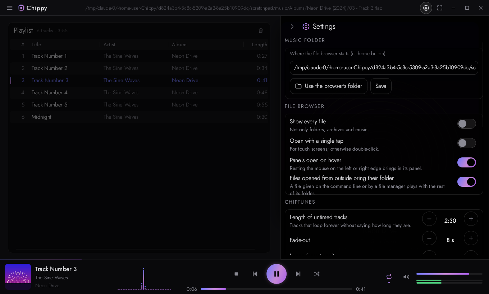

# Chippy

A music player for chiptunes (and everything else), in Rust with a
[Slint](https://slint.dev) interface. There is no library to build: a file
browser slides in from the left edge and you play music straight from your
folders, from inside zip/7z archives, and from inside multi-track chiptune
files as if they were folders.


| File browser (inside an NSF) | Settings |
| --- | --- |
|  |  |

## What it plays

| Engine | Formats |
| --- | --- |
| [Game Music Emu](https://github.com/libgme/game-music-emu) | NSF, NSFE, SPC, VGM, VGZ, GBS, HES, KSS, AY, SAP, GYM (M3U track lists next to NSF/GBS/etc. are read for track names and lengths) |
| [lazyusf2](https://github.com/derselbst/lazyusf2) | USF and miniUSF (Nintendo 64), with `_lib` chains |
| [vgmstream](https://github.com/vgmstream/vgmstream) | Hundreds of game formats: ADX, HCA, BRSTM, BCSTM, XWB, FSB, AT3, DSP, GENH/TXTH... including multi-subsong files |
| [Symphonia](https://github.com/pdeljanov/Symphonia) | MP3, FLAC, WAV, OGG Vorbis, M4A/AAC, ALAC, AIFF, CAF, MKV/WebM audio |

Tags come from [lofty](https://github.com/Serial-ATA/lofty-rs) for common
formats, and from each emulator's own metadata for chiptunes (GME track
info, PSF tags, vgmstream stream names).

## Using it

* **File browser (left edge).** Rest the mouse on the left edge, swipe in,
  tap the edge, press `B`, or click the ☰ button. It has back, forward, up,
  refresh and home (your music folder), an editable path, and a filter box
  that shows only the entries containing what you type. Extensions are
  drawn dimmer than names. By default only folders, archives and music are
  listed; the eye button shows every file.
* **Double-click a track** and the whole folder's music becomes the
  playlist, in order, starting from that track. Right-click for *Add to
  playlist*.
* **Archives** (`.zip`, `.7z`, `.tar`, `.tar.gz`) open like folders.
* **Multi-track files** (NSF, NSFE, GBS, HES, KSS, AY, SAP, and vgmstream
  files with subsongs) open like folders listing their tracks by number and
  title. A file with one track just plays.
* **Paths run through all of this**: you can type
  `~/music/nes.zip/Mega Man 2.nsfe` in the path box, or pass it on the
  command line.
* **Playlist.** Track, title, artist, album and length are shown; right-click
  the header for more columns (genre, year, system, format, sample rate,
  bitrate, channels, copyright, ripper, comment, file name, path). Drag a
  header's edge to resize. Double-click to play, `Delete` to remove.
* **Album art** on the right: an embedded picture, or `cover.jpg`,
  `folder.jpg`, `front.jpg`, `album.jpg`, `albumart*.jpg`, `artwork.jpg`
  and similar next to the music (any image as a last resort). For music in
  an archive, images in the archive and next to it (including one named like
  the archive) are used.
* **Bottom bar**: now playing (thumbnail, title, artist, album and a live
  spectrum), stop/previous/play/next, shuffle, the timeline, repeat
  (off/all/one), volume and a stereo level meter.
* **Settings (right edge, or the gear)**: music folder, browser behaviour,
  the length and fade of chiptunes that loop forever, vgmstream loop count,
  emulation options, the theme (Carlita's eleven), fullscreen, artwork
  preference and spectrum bar count. Everything applies at once and is kept
  in `~/.config/chippy/settings.json`; the playlist is kept too.
* **Touch**: panels follow a swipe, everything is finger-sized, and
  *Open with a single tap* in Settings replaces double-clicks.

Keys: `Space` play/pause, `←`/`→` seek 5 s (`Shift` 30 s), `↑`/`↓` volume,
`N`/`P` next/previous, `S` shuffle, `R` repeat, `M` mute, `B` browser, `,`
settings, `F11` fullscreen, `Esc` closes panels. In the browser: arrows,
`Enter`, `Backspace` (up), `Alt+←/→`, `F5`.

Command line:

```
chippy [--fullscreen|--windowed] [FILE or FOLDER]
```

A file plays at once with the rest of its folder (unless turned off in
Settings); dropping a file on the window does the same.

## Building

The decoders are C/C++ libraries vendored as git submodules, so clone with
them:

```bash
git clone --recursive https://github.com/singularity098/Chippy
```

You need Rust (1.80+), CMake, a C/C++ compiler, and on Linux the ALSA,
xkbcommon and fontconfig headers:

```bash
sudo apt install cmake clang libasound2-dev libxkbcommon-dev libfontconfig-dev zlib1g-dev
```

```bash
cargo run --release
```

The Skia renderer is used by default (it antialiases best); its prebuilt
binaries are downloaded during the build. Where that is not possible, build
with `--no-default-features` to use femtovg. `SLINT_BACKEND=winit-software`
runs without OpenGL.

## Layout

```
crates/
  chippy/          the app: Slint UI (ui/), audio output, player thread, spectrum
  chippy-core/     no UI: virtual file system (folders, archives, multi-track
                   files), decoders, tags, album art, playlist, settings
  gme-sys/         builds third_party/game-music-emu
  vgmstream-sys/   builds third_party/vgmstream (built-in codecs only)
  lazyusf-sys/     builds third_party/lazyusf2
```

`cargo run -p chippy-core --example probe -- PATH` lists a path the way the
browser does, with each track's tags.

The look (fonts, colours, themes, icons, the edge strips and sliding panels)
follows [Carlita](https://github.com/singularity098/Carlita).

## Licence

GPL-3.0-or-later. The vendored libraries keep their own licences: Game Music
Emu is LGPL-2.1, lazyusf2 is GPL-2.0, vgmstream is ISC-style. The Jost font
is under the SIL Open Font Licence (`assets/fonts/OFL.txt`).
