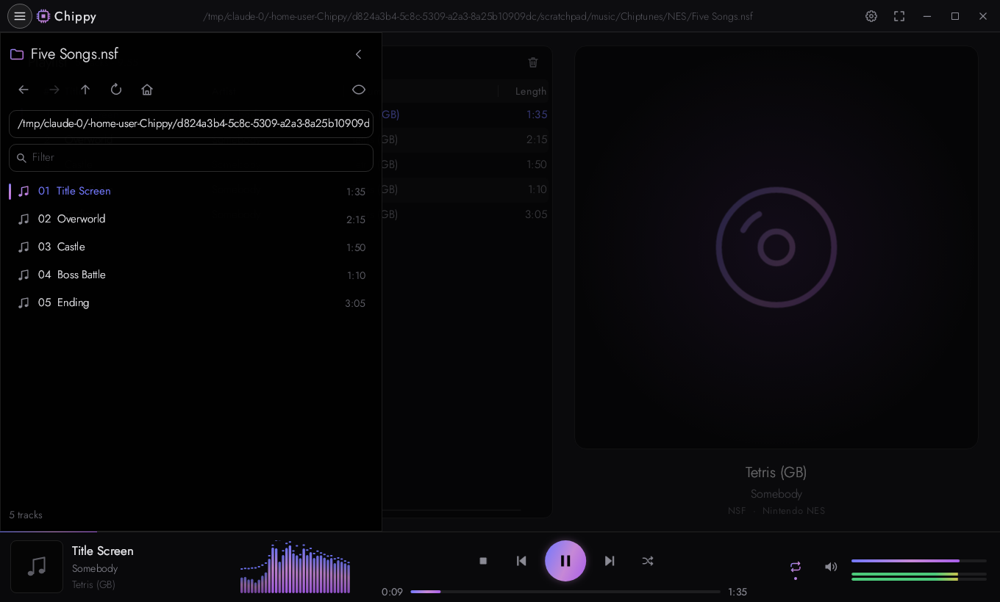

# Chippy

A music player for chiptunes (and everything else), in Rust with a
[Slint](https://slint.dev) interface on the desktop and a native
[Jetpack Compose](https://developer.android.com/compose) one on Android.
There is no library to build: a file
browser slides in from the left edge and you play music straight from your
folders, from inside zip/7z archives, and from inside multi-track chiptune
files as if they were folders.


| File browser (inside an NSF) | Settings |
| --- | --- |
|  |  |

## What it plays

| Engine | Formats |
| --- | --- |
| [Game Music Emu](https://github.com/libgme/game-music-emu) | NSF, NSFE, SPC, VGM, VGZ, GBS, HES, KSS, AY, SAP, GYM (M3U track lists next to NSF/GBS/etc. are read for track names and lengths) |
| [lazyusf2](https://github.com/derselbst/lazyusf2) | USF and miniUSF (Nintendo 64), with `_lib` chains |
| [vgmstream](https://github.com/vgmstream/vgmstream) | Hundreds of game formats: ADX, HCA, BRSTM, BCSTM, XWB, FSB, AT3, DSP, GENH/TXTH... including multi-subsong files, with MP3, Vorbis, Opus, ATRAC3, XMA and WMA streams inside them (through mpg123, libvorbis and FFmpeg) |
| [Audio Overload SDK](https://github.com/DeaDBeeF-Player/deadbeef/tree/master/plugins/psf) | PSF/miniPSF (PlayStation), PSF2/miniPSF2 (PlayStation 2), SSF/miniSSF (Saturn), DSF/miniDSF (Dreamcast), QSF/miniQSF (Capcom QSound), SPU. No console BIOS needed |
| [lazyusf2](https://github.com/derselbst/lazyusf2) | USF and miniUSF (Nintendo 64) |
| [mGBA](https://mgba.io) (GBA core) | GSF and miniGSF (Game Boy Advance) |
| vio2sf (DeSmuME) | 2SF and mini2SF (Nintendo DS) |
| [Mednafen](https://mednafen.github.io)'s WonderSwan core | WSR (Bandai WonderSwan); NEZplug-style M3Us beside it list its songs: one for them all, or one per song (shown in the browser as the songs themselves, also inside archives) |
| [libsidplayfp](https://github.com/libsidplayfp/libsidplayfp) with reSIDfp | SID (PSID/RSID, Commodore 64), all subtunes; HVSC's `Songlengths.md5` gives lengths when found above the tune |
| Chippy's own Z80 + SN76489 | SGC (Sega Master System / Game Gear; not the FM unit or ColecoVision) |
| [libxmp](https://github.com/libxmp/libxmp) | Tracker modules: MOD, XM, S3M, IT, MED, MTM, 669, OKT, STM, FAR, ULT, PTM, DBM, AMF, MDL, PSM, GDM, IMF, UMX... |
| [RustySynth](https://github.com/sinshu/rustysynth) | MIDI (MID, MIDI, KAR, RMI, SMF) through SF2 SoundFonts |
| Chippy's own `tablature` crate, then RustySynth | Tab files: Guitar Pro 3, 4 and 5 (GP3, GP4, GP5), Guitar Pro 7 and 8 (GP), MusicXML (MUSICXML, MXL), every track through the SoundFont with its repeats and tempo changes. Guitar Pro 6's GPX isn't read yet |
| [vgmstream](https://github.com/vgmstream/vgmstream) | Hundreds of game formats: ADX, HCA, BRSTM, BCSTM, XWB, FSB, AT3, DSP, GENH/TXTH... including multi-subsong files |
| [Symphonia](https://github.com/pdeljanov/Symphonia) | MP3, FLAC, WAV, OGG Vorbis, M4A/AAC, ALAC, AIFF, CAF, MKV/WebM audio (Opus in them through libopus) |
| vgmstream's FFmpeg | Opus, WMA, AC-3 |

All the PSF-family formats follow `_lib` chains to their libraries, beside
the file or inside the same archive.

Tags come from [lofty](https://github.com/Serial-ATA/lofty-rs) for common
formats, and from each emulator's own metadata for chiptunes (GME track
info, PSF tags, vgmstream stream names).

## Using it

* **File browser (left edge).** Rest the mouse on the left edge, swipe in,
  tap the edge, press `B`, or click the ☰ button. It has back, forward, up,
  refresh and home (your music folder), a path bar whose levels you click to
  jump to (the home folder shows as `~`; click beside them to type a path),
  a filter box
  that shows only the entries containing what you type, and a search box
  (`Ctrl+F`) that looks through every folder below this one, and the
  archives there, listing what it finds with the folder each is in (the
  filter then narrows the results; a track found plays with its folder).
  Extensions are
  drawn dimmer than names. By default only folders, archives and music are
  listed; the eye button shows every file.
* **Double-click a track** and the whole folder's music becomes the
  playlist, in order, starting from that track. Right-click for *Add to
  playlist*.
* **Archives** (`.zip`, `.7z`, `.tar`, `.tar.gz`, `.rar`, and `.rsn` SNES
  music packs) open like folders.
* **Multi-track files** (NSF, NSFE, GBS, HES, KSS, AY, SAP, SID, SGC, WSR
  with an M3U, and vgmstream files with subsongs) open like folders listing their tracks by number and
  title. A file with one track just plays.
* **Paths run through all of this**: you can type
  `~/music/nes.zip/Mega Man 2.nsfe` in the path box, or pass it on the
  command line.
* **Playlist.** Track, title, artist, album and length are shown; right-click
  the header for more columns (genre, year, system, format, sample rate,
  bitrate, channels, copyright, ripper, comment, file name, path). Drag a
  header's edge to resize. Double-click to play, `Delete` to remove.
  Right-click a track for *Properties…* (every tag and detail, with *Copy
  all*) and *Export…*.
* **Export** the playlist (or one track) to WAV, FLAC, MP3 or Opus: the
  button above the playlist. One tagged file per track; looping chiptunes
  end as they play, at their length with the fade. Or to **MusicXML** or
  **Guitar Pro 5**: the pitched parts as tab in bars (as the guitar tab
  shows them; the track open in it, with its changes). Or to **MIDI**: the
  notes, worked out from what a tune does to its sound chips (NES, with its
  cartridge chips: VRC6, VRC7, FDS, MMC5, N163, 5B; SNES; Genesis and the
  other chips VGM logs, OPN, OPL and OPM FM among them; Game Boy, Game Boy
  Advance, PC Engine, MSX with its SCC and FM, ZX Spectrum and Amstrad CPC,
  Master System, Atari, Commodore 64, WonderSwan, PlayStation 1 and 2,
  Nintendo DS) or read from a tracker module's patterns, a MIDI track per
  channel, in the track's bars (its tempo and time signature, so the notes
  fall on the beats in a sequencer). Most GBA music is mixed by Nintendo's
  m4a (Sappy) engine, whose notes are read from the engine itself.
  Sampled instruments (SNES, PlayStation, DS, GBA, modules) are measured
  and named to pick each one's General MIDI instrument, and unpitched
  samples become drums. MIDI is greyed out for tracks whose notes can't be
  found: recorded audio (MP3, FLAC, vgmstream's formats) and the N64,
  Saturn, Dreamcast and QSound.
* **Lyrics** (`L`, or the speech-bubble button by the volume): from an
  `.lrc` file beside the track (timed: the line being sung is marked and
  kept in view, a faint `[1:23]` beside each line says when it is sung,
  and a click jumps to a line), the file's tags, a karaoke MIDI file, or a
  `.txt` file beside it.
* **Tab files** play like MIDI files, and the guitar tab (below) shows them
  as written: each track's tuning and capo (*As written (D A D G B E,
  capo 2)* among the tunings), every note on the string and fret the file
  gives, in the file's own bars. Another tuning, *Octave* or *Neck* works
  out a fingering of Chippy's own, as for any other track.
* **Guitar tab** (`T`, or the guitar button): the playing track's notes laid
  out for guitar (standard, drop D, half step down), 7-string guitar (B
  standard, drop A), bass or ukulele, a part (channel) at a time, starting
  with the lead; the notes are spaced to fit the window without touching,
  with a playhead that follows the song; *Copy* gives the tab as text.
  Another part or instrument keeps the same bars in view. Notes played
  softer than those around them (an echo of a note just played, the way
  chip tunes fake a delay) are shown in brackets, dimmer: `(5)`. *Merge…*
  reads two parts as one, added to the list of parts ("Pulse 1 + Pulse 2"):
  for a tune split across channels, to pan it or let its notes ring on,
  like the arpeggios of Zelda's dungeon theme; merge it again to add a
  third, or take it apart.
  *Octave* shows the part an octave higher or lower; *Neck* nudges its
  shapes up or down the neck, a step at a time: the lowest-fretted notes of
  each passage move to a lower string, played higher up (or the highest to
  a higher string), to find a more comfortable way to play a riff.
  **Bars**: the tab has bar lines and bar numbers. MIDI files say where
  the bars fall, and tracker modules nearly do (four rows to a beat, a bar
  starting with each pattern); for other chiptunes, which hold only their
  sound driver's code, the beat and the bars are worked out from the notes
  (the step the notes move in, the beat they lean on, where the bass and
  the kick drum put their weight, and how the music repeats). That can be
  wrong, so the *Bars* row puts it right: the time signature, the beat
  twice or half as fast, and the bar lines a beat earlier or later. Click a
  bar (Shift-click for a run of them; on Android tap, and hold for a run)
  and *Neck* moves just those bars' shapes, leaving the rest as they are;
  double-click a bar to play from it. All of this is remembered for each
  track and part until Chippy closes, never saved. *Save…* writes every
  part as tab in bars: **MusicXML** (sheet music and tab, for MuseScore,
  Guitar Pro, TuxGuitar, Sibelius...) or **Guitar Pro 5** (`.gp5`), as
  shown, with times rounded to sixteenths (or triplets, where the notes fit
  them clearly better).
* **MIDI mode** (`Shift+M`, or the keyboard button beside the guitar): a
  chiptune whose notes can be found (the same tracks as the guitar tab)
  plays them as MIDI through the SoundFont, crossfading from the chip and
  back again as it is turned on and off. Hold the button (or right-click
  it) to pick the instruments: the original ones (each chip channel's
  nearest General MIDI instrument), piano, strings, rock band, jazz combo,
  brass band or music box, each giving the tune, the bass and the parts in
  between instruments of their own. The mode stays on from track to track;
  tracks without notes to find play as they are. The notes are worked out
  in the background the first time (the chip plays meanwhile, the button's
  dot pulsing), and the MIDI follows the chip's loudness and its fade.
  Chippy always starts with it off.
* Lyrics and the tab slide up over the player, the transport still below
  them, and slide back down with the arrow, a drag or `Esc`. Their buttons
  are greyed out when a track has no lyrics, or its notes can't be found.
* **Open a file** with the button in the title bar (`Ctrl+O`), or drop
  files on the window: the first plays, the rest join the playlist.
* **Album art** on the right: an embedded picture, or `cover.jpg`,
  `folder.jpg`, `front.jpg`, `album.jpg`, `albumart*.jpg`, `artwork.jpg`
  and similar next to the music (any image as a last resort). For music in
  an archive, images in the archive and next to it (including one named like
  the archive) are used.
* **Bottom bar**: now playing (thumbnail, title, artist and album),
  stop/previous/play/next, shuffle, the timeline, a live spectrum, repeat
  (off/all/one) and volume.
* **Settings (right edge, or the gear)**: music folder (typed, or picked
  with *Choose…*), browser behaviour,
  the length and fade of chiptunes that loop forever, vgmstream loop count,
  emulation options, the theme (Carlita's eleven), fullscreen, artwork
  preference and spectrum bar count. Everything applies at once and is kept
  in `~/.config/chippy/settings.json` (on Windows
  `%APPDATA%\chippy\config\settings.json`, or the `chippy-settings` folder
  beside `chippy.exe` in the portable zip). Each start begins in the music folder
  with an empty playlist.
* **MIDI**: choose a folder of SF2 SoundFonts in Settings. The SoundFont in
  use can change while a song plays (the list in Settings, the arrows beside
  the title in the bottom bar, or `[` and `]`); the song crossfades to it.
* **Media keys** and the desktop's player controls work (MPRIS on Linux,
  the media overlay on Windows).
* **Touch**: panels follow a swipe, lists scroll with a finger (on a
  desktop's touch screen too, while a mouse still drags rows), everything is
  finger-sized, and *Open with a single tap* in Settings replaces
  double-clicks.
* **Zoom**: text and controls grow with `Ctrl+plus` and shrink with
  `Ctrl+minus` (`Ctrl+0` resets), with `Ctrl` and the mouse wheel, or with
  *Zoom* in Settings.
* **Wayland**: on a Wayland desktop Chippy runs through XWayland, where
  dropping files on the window and the window's icon work (the toolkit
  supports neither natively yet). *Native Wayland window* in Settings, or
  `CHIPPY_WAYLAND=1`, runs it natively; it then installs a desktop entry
  and icon in `~/.local/share` if none is installed, so the taskbar shows
  Chippy's icon. Double-click the title bar to maximise or restore.
* **The window** opens as it was left: its size and place (where the window
  system says; Wayland does not), maximised, or fullscreen. In fullscreen
  the title bar comes in when the mouse rests on the top edge, as the
  sidebars do.

Keys: `Space` play/pause, `←`/`→` seek 5 s (`Shift` 30 s), `↑`/`↓` volume,
`N`/`P` next/previous, `S` shuffle, `R` repeat, `M` mute, `[`/`]` SoundFont,
`B` browser, `,`
settings, `Ctrl+O` open a file, `Ctrl+F` search, `Ctrl+plus`/`Ctrl+minus` zoom, `F11` fullscreen, `Esc` closes panels. In the browser: arrows,
`Enter`, `Backspace` (up), `Alt+←/→`, `F5`.

Command line:

```
chippy [--fullscreen|--windowed] [FILE or FOLDER]
```

A file plays at once with the rest of its folder (unless turned off in
Settings); dropping a file on the window does the same.

## Downloads

GitHub Actions builds the `chippy` binary for Linux (x86_64 and aarch64)
on every push (as a workflow artifact) and attaches it to a release for
every `v*` tag. It needs ALSA, fontconfig and xkbcommon at run time, which
desktop distributions have.

For **Windows** (10 or 11, x86_64) every push builds an installer and a
portable zip (`.github/workflows/windows.yml`), attached to releases too:

* **Installer** (`chippy-…-setup.exe`): installs for you alone by default,
  with no administrator prompt (into `%LOCALAPPDATA%\Programs\Chippy`), or
  for everyone on the PC. It adds a Start menu entry, optionally a desktop
  one, and lists Chippy under *Open with* for chiptunes, modules and other
  music without changing your default player. A new version installs over
  the old one. Uninstall it from *Settings → Apps*: it then asks whether to
  delete your settings too (no, by default; a silent uninstall keeps them).
* **Portable zip**: unzip anywhere and run `chippy.exe`. Settings stay in
  the `chippy-settings` folder beside it, so deleting the folder removes
  everything (delete just `chippy-settings` to keep them in your profile
  instead).

Neither is code-signed yet, so Windows SmartScreen warns the first time:
*More info → Run anyway*.

An Android APK (arm64, Android 8 or newer) is built on every push too
(`.github/workflows/android.yml`): download it from the run's *Artifacts*
on the Actions tab, unzip it and open the `.apk` on the phone (allow
installing from that app when asked). Every build is signed with the same
key, so a new one installs over the last without losing settings.

### On Android

The Android app has its own interface, written in Jetpack Compose with
Material 3 (Chippy's themes and font included) over the same Rust engine,
so it scrolls, animates and responds the way Android apps do. The player
fills the screen: the cover, the title, the spectrum, the timeline and the
transport, with what comes next at the bottom (a tap there, or on the
title, opens the playlist). Turned sideways, the cover and the controls sit
side by side. The file browser (the folder button, top left) and the
settings (the gear, top right) open as pages of their own, and the back
button or gesture closes them; in the browser, back retraces the folders
you opened first. A tap opens a folder or plays a track with the rest of
its folder; a long press adds it to the playlist instead. The field above
the listing filters the folder, or searches everything below it (*Below*).
In the playlist, swipe a track away to remove it; its menu shows it in the
browser, its properties, or exports it. The buttons beside the playlist's
at the top of the player show the playing track's lyrics and guitar tab
(greyed out when there are none), over the player with a small transport
below them. The keyboard button beside them turns MIDI mode on and off; a
long press picks its instruments.

At the first start Chippy asks for *All files access*, as the file browser
reads folders anywhere in shared storage (it starts in *Internal storage*;
add music folders in Settings, or from the browser's menu). Music keeps
playing with the screen off or another app in front, with the usual media
notification, lock-screen and headset controls; a call or unplugged
headphones pause it. Back from the player sends Chippy to the background;
swiping it away from the recent apps stops it.

## Building

The decoders are C/C++ libraries vendored as git submodules, so clone with
them:

```bash
git clone --recursive https://github.com/singularity098/Chippy
```

You need Rust (1.88+), CMake, pkg-config, a C/C++ compiler, and on Linux
the ALSA, xkbcommon and fontconfig headers, plus mpg123, libvorbis and
FFmpeg for vgmstream and libopus for Opus in WebM and exporting Opus (without it, the
bundled Opus source is built):

```bash
sudo apt install cmake clang pkg-config libasound2-dev libxkbcommon-dev libfontconfig-dev zlib1g-dev \
  libmpg123-dev libvorbis-dev libavformat-dev libavcodec-dev libavutil-dev libswresample-dev libopus-dev
```

```bash
cargo run --release
```

### Windows

The Windows build is cross-compiled from Linux with MinGW-w64, as the
workflow does (its POSIX-threads compilers, for the emulators' C++):

```bash
sudo apt install cmake pkg-config mingw-w64
sudo update-alternatives --set x86_64-w64-mingw32-gcc /usr/bin/x86_64-w64-mingw32-gcc-posix
sudo update-alternatives --set x86_64-w64-mingw32-g++ /usr/bin/x86_64-w64-mingw32-g++-posix
rustup target add x86_64-pc-windows-gnu
packaging/build-codecs.sh windows
CHIPPY_CODECS=$PWD/build/codecs/windows LIBOPUS_STATIC=1 LIBOPUS_NO_PKG=1 \
  cargo build --release --target x86_64-pc-windows-gnu --no-default-features
```

`chippy.exe` is in `target/x86_64-pc-windows-gnu/release/`; it needs no
DLLs beyond Windows' own. `--no-default-features` draws with femtovg, as
Skia has no prebuilt library for MinGW. The installer is made with
[Inno Setup](https://jrsoftware.org/isinfo.php) 6.3 or newer, on Windows:
`iscc /DAppVersion=0.1.0 /DSourceDir=<folder with chippy.exe, README.md and
LICENSE> packaging\windows\chippy.iss`.

### Android

The app is two halves: the Rust engine (`crates/chippy-android`, built as a
`cdylib` with cargo-ndk, the same playback engine and decoders as the
desktop's), and the Compose UI in Kotlin (`android/`), which calls the
engine through bindings [UniFFI](https://mozilla.github.io/uniffi-rs/)
generates from it. `build-apk.sh` does all of it. You need the Android SDK
(platform 35, build-tools 35) and NDK (r27), JDK 17+, Gradle 8, the Rust
target and cargo-ndk:

```bash
rustup target add aarch64-linux-android
cargo install cargo-ndk
export ANDROID_HOME=~/Android/Sdk ANDROID_NDK_HOME=~/Android/Sdk/ndk/27.2.12479018
android/build-apk.sh          # or: android/build-apk.sh debug
```

The first run builds FFmpeg, mpg123, libvorbis and libogg for vgmstream
into `build/codecs` (`packaging/build-codecs.sh`, a minute or two). The APK is
in `android/app/build/outputs/apk/`. Once the script has run, `android/` opens
in Android Studio as it is (the engine and its bindings are in place; run the
script again after changing the Rust side). `cargo test -p chippy-android`
drives the engine on the desktop as the app does.

### Downloads

Every push builds one Linux package (`.github/workflows/release.yml`), a
Windows installer and portable zip (`.github/workflows/windows.yml`) and
one Android APK (`.github/workflows/android.yml`); download them from the
run's *Artifacts* on the Actions tab. The Linux binary has FFmpeg, mpg123
and libvorbis built in (`packaging/build-codecs.sh linux`, then
`CHIPPY_CODECS=$PWD/build/codecs/linux cargo build --release`), so it does
not depend on the FFmpeg version your system has. It needs glibc 2.35 or
newer (Ubuntu 22.04, Debian 12, Fedora 36 and later) and, as any desktop
has, ALSA and fontconfig.

The Skia renderer is used by default (it antialiases best); its prebuilt
binaries are downloaded during the build. Where that is not possible, build
with `--no-default-features` to use femtovg. `SLINT_BACKEND=winit-software`
runs without OpenGL.

## Layout

```
crates/
  chippy/          the desktop app: Slint UI (ui/) and what drives it
  chippy-android/  the Android app's engine: the same logic with no UI,
                   exposed to Kotlin through UniFFI (a cdylib)
  chippy-engine/   playback, shared by both: audio output, player thread,
                   resampling, spectrum, album art, exporting
  chippy-core/     no UI: virtual file system (folders, archives, multi-track
                   files), decoders, tags, album art, playlist, settings
  tablature/       no audio, no UI: notes, beats and bars, guitar tab
                   fingering, Guitar Pro and MusicXML read and written
                   (chippy-core re-exports it as notes::{tab, score, ...})
  uniffi-bindgen/  generates chippy-android's Kotlin bindings
  gme-sys/         builds third_party/game-music-emu
  vgmstream-sys/   builds third_party/vgmstream, with mpg123, libvorbis and
                   FFmpeg (the system's, or static ones from
                   packaging/build-codecs.sh)
  lazyusf-sys/     builds third_party/lazyusf2
  aosdk-sys/       third_party/aosdk (PSF, PSF2, SSF, DSF, QSF)
  gsf-sys/         third_party/mgba-gsf (GSF)
  twosf-sys/       third_party/vio2sf (2SF)
  wsr-sys/         third_party/wsr (WSR)
  sidplayfp-sys/   third_party/libsidplayfp (SID)
  xmp-sys/         third_party/libxmp (tracker modules)
  archive-sys/     third_party/libarchive (RAR, RSN)
android/           the Android app: the Compose UI, media session and
                   playback service in Kotlin (Gradle), and build-apk.sh
```

`cargo run -p chippy-core --example probe -- PATH` lists a path the way the
browser does, with each track's tags;
`cargo run -p chippy-core --example decode -- FILE` decodes a file to the
end to check that it plays.

The look (fonts, colours, themes, icons, the edge strips and sliding panels)
follows [Carlita](https://github.com/singularity098/Carlita).

## Licence

GPL-3.0-or-later. The vendored libraries keep their own licences: Game Music
Emu is LGPL-2.1, lazyusf2, vio2sf, Mednafen and libsidplayfp are GPL-2.0+,
the Audio Overload SDK is BSD with MAME-licensed parts, mGBA is MPL-2.0,
libxmp is MIT, libarchive is BSD, vgmstream is ISC-style. The Linux
and Windows packages and the APK also carry mpg123 (LGPL-2.1), libvorbis and libogg
(BSD) and FFmpeg (built under the GPL). The Jost font
is under the SIL Open Font Licence (`assets/fonts/OFL.txt`).
