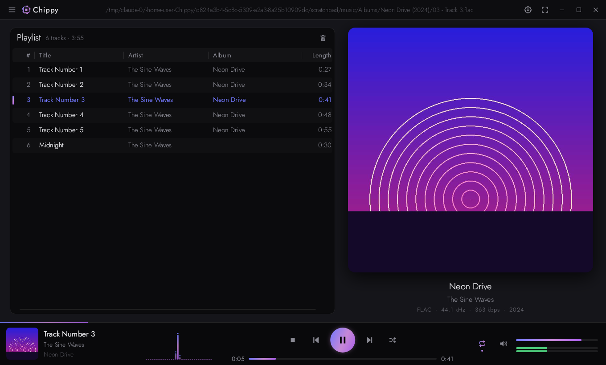

# Chippy

A music player for chiptunes (and everything else), in Rust with a
[Slint](https://slint.dev) interface. There is no library to build: a file
browser slides in from the left edge and you play music straight from your
folders, from inside zip/7z archives, and from inside multi-track chiptune
files as if they were folders.



| File browser (inside an NSF) | Settings |
| --- | --- |
|  |  |

## What it plays

| Engine | Formats |
| --- | --- |
| [Game Music Emu](https://github.com/libgme/game-music-emu) | NSF, NSFE, SPC, VGM, VGZ, GBS, HES, KSS, AY, SAP, GYM (M3U track lists next to NSF/GBS/etc. are read for track names and lengths) |
| [lazyusf2](https://github.com/derselbst/lazyusf2) | USF and miniUSF (Nintendo 64), with `_lib` chains |
| [vgmstream](https://github.com/vgmstream/vgmstream) | Hundreds of game formats: ADX, HCA, BRSTM, BCSTM, XWB, FSB, AT3, DSP, GENH/TXTH... including multi-subsong files, with MP3, Vorbis, Opus, ATRAC3, XMA and WMA streams inside them (through mpg123, libvorbis and FFmpeg) |
| [Audio Overload SDK](https://github.com/DeaDBeeF-Player/deadbeef/tree/master/plugins/psf) | PSF/miniPSF (PlayStation), PSF2/miniPSF2 (PlayStation 2), SSF/miniSSF (Saturn), DSF/miniDSF (Dreamcast), QSF/miniQSF (Capcom QSound), SPU. No console BIOS needed |
| [lazyusf2](https://github.com/derselbst/lazyusf2) | USF and miniUSF (Nintendo 64) |
| [mGBA](https://mgba.io) (GBA core) | GSF and miniGSF (Game Boy Advance) |
| vio2sf (DeSmuME) | 2SF and mini2SF (Nintendo DS) |
| [Mednafen](https://mednafen.github.io)'s WonderSwan core | WSR (Bandai WonderSwan); NEZplug-style M3Us beside it list its songs: one for them all, or one per song (shown in the browser as the songs themselves, also inside archives) |
| [libsidplayfp](https://github.com/libsidplayfp/libsidplayfp) with reSIDfp | SID (PSID/RSID, Commodore 64), all subtunes; HVSC's `Songlengths.md5` gives lengths when found above the tune |
| Chippy's own Z80 + SN76489 | SGC (Sega Master System / Game Gear; not the FM unit or ColecoVision) |
| [libxmp](https://github.com/libxmp/libxmp) | Tracker modules: MOD, XM, S3M, IT, MED, MTM, 669, OKT, STM, FAR, ULT, PTM, DBM, AMF, MDL, PSM, GDM, IMF, UMX... |
| [RustySynth](https://github.com/sinshu/rustysynth) | MIDI (MID, MIDI, KAR, RMI, SMF) through SF2 SoundFonts |
| [vgmstream](https://github.com/vgmstream/vgmstream) | Hundreds of game formats: ADX, HCA, BRSTM, BCSTM, XWB, FSB, AT3, DSP, GENH/TXTH... including multi-subsong files |
| [Symphonia](https://github.com/pdeljanov/Symphonia) | MP3, FLAC, WAV, OGG Vorbis, M4A/AAC, ALAC, AIFF, CAF, MKV/WebM audio (Opus in them through libopus) |
| vgmstream's FFmpeg | Opus, WMA, AC-3 |

All the PSF-family formats follow `_lib` chains to their libraries, beside
the file or inside the same archive.

Tags come from [lofty](https://github.com/Serial-ATA/lofty-rs) for common
formats, and from each emulator's own metadata for chiptunes (GME track
info, PSF tags, vgmstream stream names).

## Using it

* **File browser (left edge).** Rest the mouse on the left edge, swipe in,
  tap the edge, press `B`, or click the ☰ button. It has back, forward, up,
  refresh and home (your music folder), a path bar whose levels you click to
  jump to (the home folder shows as `~`; click beside them to type a path),
  a filter box
  that shows only the entries containing what you type, and a search box
  (`Ctrl+F`) that looks through every folder below this one, and the
  archives there, listing what it finds with the folder each is in (the
  filter then narrows the results; a track found plays with its folder).
  Extensions are
  drawn dimmer than names. By default only folders, archives and music are
  listed; the eye button shows every file.
* **Double-click a track** and the whole folder's music becomes the
  playlist, in order, starting from that track. Right-click for *Add to
  playlist*.
* **Archives** (`.zip`, `.7z`, `.tar`, `.tar.gz`, `.rar`, and `.rsn` SNES
  music packs) open like folders.
* **Multi-track files** (NSF, NSFE, GBS, HES, KSS, AY, SAP, SID, SGC, WSR
  with an M3U, and vgmstream files with subsongs) open like folders listing their tracks by number and
  title. A file with one track just plays.
* **Paths run through all of this**: you can type
  `~/music/nes.zip/Mega Man 2.nsfe` in the path box, or pass it on the
  command line.
* **Playlist.** Track, title, artist, album and length are shown; right-click
  the header for more columns (genre, year, system, format, sample rate,
  bitrate, channels, copyright, ripper, comment, file name, path). Drag a
  header's edge to resize. Double-click to play, `Delete` to remove.
  Right-click a track for *Properties…* (every tag and detail, with *Copy
  all*) and *Export…*.
* **Export** the playlist (or one track) to WAV, FLAC, MP3 or Opus: the
  button above the playlist. One tagged file per track; looping chiptunes
  end as they play, at their length with the fade.
* **Open a file** with the button in the title bar (`Ctrl+O`), or drop
  files on the window: the first plays, the rest join the playlist.
* **Album art** on the right: an embedded picture, or `cover.jpg`,
  `folder.jpg`, `front.jpg`, `album.jpg`, `albumart*.jpg`, `artwork.jpg`
  and similar next to the music (any image as a last resort). For music in
  an archive, images in the archive and next to it (including one named like
  the archive) are used.
* **Bottom bar**: now playing (thumbnail, title, artist, album and a live
  spectrum), stop/previous/play/next, shuffle, the timeline, repeat
  (off/all/one), volume and a stereo level meter.
* **Settings (right edge, or the gear)**: music folder (typed, or picked
  with *Choose…*), browser behaviour,
  the length and fade of chiptunes that loop forever, vgmstream loop count,
  emulation options, the theme (Carlita's eleven), fullscreen, artwork
  preference and spectrum bar count. Everything applies at once and is kept
  in `~/.config/chippy/settings.json`. Each start begins in the music folder
  with an empty playlist.
* **MIDI**: choose a folder of SF2 SoundFonts in Settings. The SoundFont in
  use can change while a song plays (the list in Settings, the arrows beside
  the title in the bottom bar, or `[` and `]`); the song crossfades to it.
* **Media keys** and the desktop's player controls work (MPRIS on Linux).
* **Touch**: panels follow a swipe, everything is finger-sized, and
  *Open with a single tap* in Settings replaces double-clicks.
* **Wayland**: on a Wayland desktop Chippy runs through XWayland, where
  dropping files on the window and the window's icon work (the toolkit
  supports neither natively yet). *Native Wayland window* in Settings, or
  `CHIPPY_WAYLAND=1`, runs it natively; it then installs a desktop entry
  and icon in `~/.local/share` if none is installed, so the taskbar shows
  Chippy's icon. Double-click the title bar to maximise or restore.
* **The window** opens as it was left: its size and place (where the window
  system says; Wayland does not), maximised, or fullscreen. In fullscreen
  the title bar comes in when the mouse rests on the top edge, as the
  sidebars do.

Keys: `Space` play/pause, `←`/`→` seek 5 s (`Shift` 30 s), `↑`/`↓` volume,
`N`/`P` next/previous, `S` shuffle, `R` repeat, `M` mute, `[`/`]` SoundFont,
`B` browser, `,`
settings, `Ctrl+O` open a file, `Ctrl+F` search, `F11` fullscreen, `Esc` closes panels. In the browser: arrows,
`Enter`, `Backspace` (up), `Alt+←/→`, `F5`.

Command line:

```
chippy [--fullscreen|--windowed] [FILE or FOLDER]
```

A file plays at once with the rest of its folder (unless turned off in
Settings); dropping a file on the window does the same.

## Downloads

GitHub Actions builds the `chippy` binary for Linux (x86_64 and aarch64)
on every push (as a workflow artifact) and attaches it to a release for
every `v*` tag. It needs ALSA, fontconfig and xkbcommon at run time, which
desktop distributions have.

An Android APK (arm64, Android 8 or newer) is built on every push too
(`.github/workflows/android.yml`): download it from the run's *Artifacts*
on the Actions tab, unzip it and open the `.apk` on the phone (allow
installing from that app when asked). Every build is signed with the same
key, so a new one installs over the last without losing settings.

### On Android

Held upright, the player looks like a phone's: the cover large, the title
under it, the timeline and transport below, and the playlist one tap away:
the playlist button at the top, the title, or the *Up next* line at the
bottom, whose page slides up (the back button brings the player back).
Turned sideways, or on a tablet, it is the desktop's layout. The file
browser and the settings slide in from the left and right edges as on the
desktop (or from the ☰ and gear buttons); a single tap plays.

At the first start Chippy asks for *All files access*, as the file browser
reads folders anywhere in shared storage (it starts in `/storage/emulated/0`;
set the music folder in Settings with *Use the browser's folder*). Music
keeps playing with the screen off or another app in front, with the usual
media notification, lock-screen and headset controls; a call or unplugged
headphones pause it. Back with nothing open sends Chippy to the background;
swiping it away from the recent apps stops it.

## Building

The decoders are C/C++ libraries vendored as git submodules, so clone with
them:

```bash
git clone --recursive https://github.com/singularity098/Chippy
```

You need Rust (1.88+), CMake, pkg-config, a C/C++ compiler, and on Linux
the ALSA, xkbcommon and fontconfig headers, plus mpg123, libvorbis and
FFmpeg for vgmstream and libopus for Opus in WebM and exporting Opus (without it, the
bundled Opus source is built):

```bash
sudo apt install cmake clang pkg-config libasound2-dev libxkbcommon-dev libfontconfig-dev zlib1g-dev \
  libmpg123-dev libvorbis-dev libavformat-dev libavcodec-dev libavutil-dev libswresample-dev libopus-dev
```

```bash
cargo run --release
```

### Android

You need the Android SDK (platform 35, build-tools 35) and NDK (r27),
JDK 17+, Gradle 8, the Rust target and cargo-ndk:

```bash
rustup target add aarch64-linux-android
cargo install cargo-ndk
export ANDROID_HOME=~/Android/Sdk ANDROID_NDK_HOME=~/Android/Sdk/ndk/27.2.12479018
android/build-apk.sh          # or: android/build-apk.sh debug
```

The first run builds FFmpeg, mpg123, libvorbis and libogg for vgmstream
into `build/codecs` (`packaging/build-codecs.sh`, a minute or two). The APK is
in `android/app/build/outputs/apk/`. `CHIPPY_MOBILE=1 cargo run` shows the
phone's layout on the desktop (make the window taller than wide).

### Downloads

Every push builds one Linux package (`.github/workflows/release.yml`) and
one Android APK (`.github/workflows/android.yml`); download them from the
run's *Artifacts* on the Actions tab. The Linux binary has FFmpeg, mpg123
and libvorbis built in (`packaging/build-codecs.sh linux`, then
`CHIPPY_CODECS=$PWD/build/codecs/linux cargo build --release`), so it does
not depend on the FFmpeg version your system has. It needs glibc 2.35 or
newer (Ubuntu 22.04, Debian 12, Fedora 36 and later) and, as any desktop
has, ALSA and fontconfig.

The Skia renderer is used by default (it antialiases best); its prebuilt
binaries are downloaded during the build. Where that is not possible, build
with `--no-default-features` to use femtovg. `SLINT_BACKEND=winit-software`
runs without OpenGL.

## Layout

```
crates/
  chippy/          the app: Slint UI (ui/), audio output, player thread, spectrum
  chippy-android/  the library Android's activity loads (android_main)
  chippy-core/     no UI: virtual file system (folders, archives, multi-track
                   files), decoders, tags, album art, playlist, settings
  gme-sys/         builds third_party/game-music-emu
  vgmstream-sys/   builds third_party/vgmstream, with mpg123, libvorbis and
                   FFmpeg (the system's, or static ones from
                   packaging/build-codecs.sh)
  lazyusf-sys/     builds third_party/lazyusf2
  aosdk-sys/       third_party/aosdk (PSF, PSF2, SSF, DSF, QSF)
  gsf-sys/         third_party/mgba-gsf (GSF)
  twosf-sys/       third_party/vio2sf (2SF)
  wsr-sys/         third_party/wsr (WSR)
  sidplayfp-sys/   third_party/libsidplayfp (SID)
  xmp-sys/         third_party/libxmp (tracker modules)
  archive-sys/     third_party/libarchive (RAR, RSN)
android/           the Android app (Gradle, a little Java: the activity,
                   media session and playback service) and its build scripts
```

`cargo run -p chippy-core --example probe -- PATH` lists a path the way the
browser does, with each track's tags;
`cargo run -p chippy-core --example decode -- FILE` decodes a file to the
end to check that it plays.

The look (fonts, colours, themes, icons, the edge strips and sliding panels)
follows [Carlita](https://github.com/singularity098/Carlita).

## Licence

GPL-3.0-or-later. The vendored libraries keep their own licences: Game Music
Emu is LGPL-2.1, lazyusf2, vio2sf, Mednafen and libsidplayfp are GPL-2.0+,
the Audio Overload SDK is BSD with MAME-licensed parts, mGBA is MPL-2.0,
libxmp is MIT, libarchive is BSD, vgmstream is ISC-style. The Linux
package and the APK also carry mpg123 (LGPL-2.1), libvorbis and libogg
(BSD) and FFmpeg (built under the GPL). The Jost font
is under the SIL Open Font Licence (`assets/fonts/OFL.txt`).
